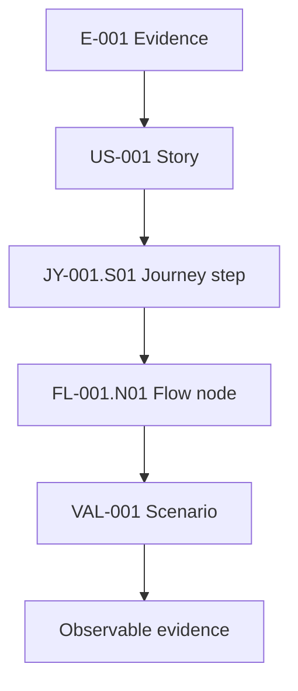

## Purpose

Use UX Planner when the experience’s intent must remain traceable during prototyping, user testing and handoff. The skill and application have different responsibilities: [see the tool](/docs/tools/ux-planner).

## Procedure

1. Read the decision or source and only the affected artifact.
2. The main agent or assigned author applies `jado-ux-artifacts`, without mandatory delegation.
3. Choose a journey for context and stages, a flow for actions, decisions, errors and recovery; create stories and personas only if the outcome needs them.
4. Verify relevant branches, references and states. Preserve IDs and a single canonical location.
5. Deliver the change, rationale and evidence. For a requested extended baseline, use `jado-ux-traceability` and link artifacts without duplicating them.

The diagram above illustrates one possible chain: it does not require every document for every assignment. Explain an irrelevant relationship instead of filling it with invented information.

## Where to put files

In new projects, use `docs/ux/` with `personas/`, `user-stories/`, `user-journeys/`, `user-flows/`. Canonical journeys are JSON boards; flows, stories and personas use Markdown. The extended dossier, when requested, lives in `initiatives/<id>/` and links the four collections.

In existing projects, preserve the canonical location until a verified migration during setup. The UX Planner version with a fixed `docs/02-design/` root must be updated before it can read `docs/ux/`. Do not maintain two editable copies or use symlinks to bypass the limitation.

## Outcome and completion criterion

The change meets the assigned criteria, affected links and IDs remain valid, and relevant errors and recovery paths have an outcome. Declare observed coverage and unresolved decisions. A schema check does not certify a user test or a save in the app.

Sources: [UX procedures](/docs/automation/ux-planner) and [tool](/docs/tools/ux-planner).
