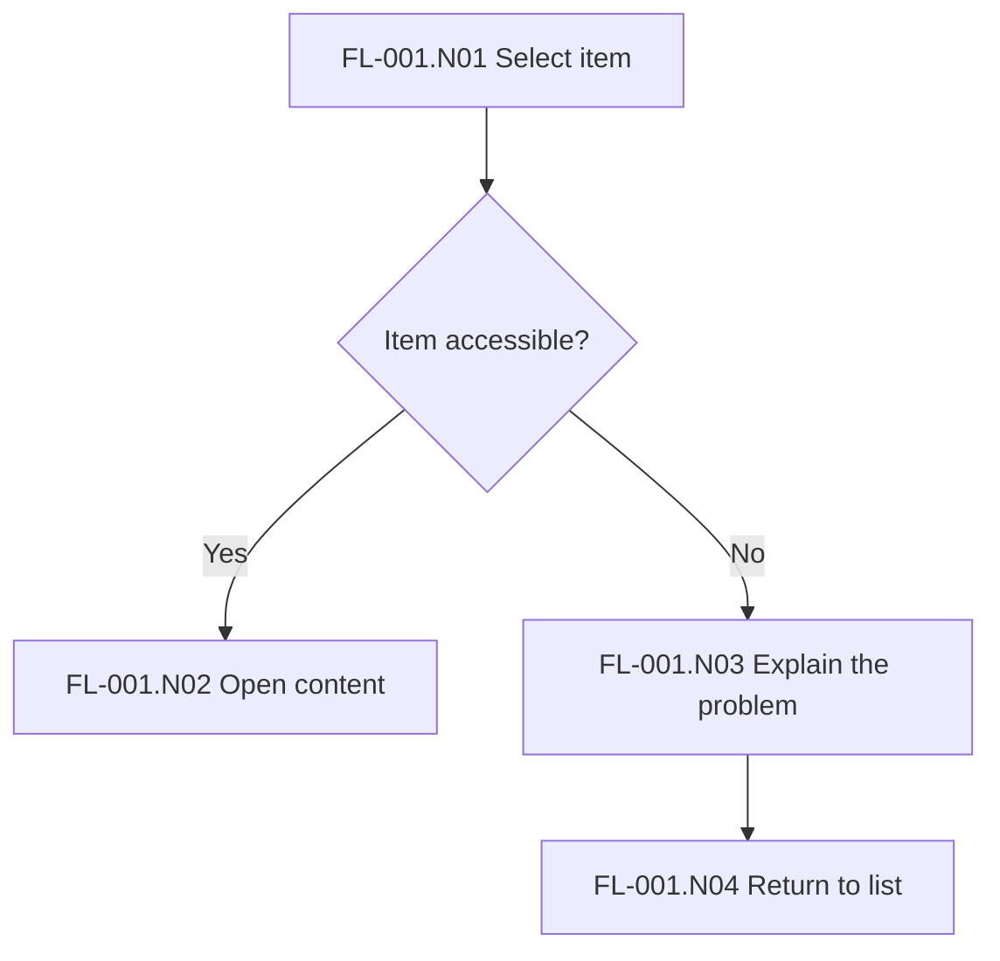

## Scenario

A user needs to reopen a saved item. The item may be available or no longer accessible. This teaching example shows how to use the UX contract without depending on a specific application’s domain.

## Artifact chain

| Artifact | Example | Link |
| --- | --- | --- |
| E-001 — decision | The user must be able to reopen an item from their list | Requirement source |
| US-001 — story | As a user, I want to reopen an item to continue my work | E-001 |
| JY-001.S01 — journey step | Identify the work to resume | US-001 |
| FL-001.N01 — flow node | Select an item from the list | JY-001.S01 |
| VAL-001 — validation | If available, the item opens with its content | US-001, FL-001.N02 |
| VAL-002 — validation | If inaccessible, the message explains the problem and lets the user return to the list | US-001, FL-001.N03 |

## Flow

## How to apply it in the project

1. Record the actual decision and its source in `sources.md`.
2. Define stories and journeys using the product’s language.
3. Specify flows, access conditions and outcomes. Add a retry only if the problem can be temporary.
4. Link each promised outcome to a validation scenario.
5. Make the chain navigable in `traceability.md`.

## Completion criterion

The error path is part of the experience to prototype and observe. Testing only the happy path does not cover US-001 if the user can also encounter an inaccessible item.

References: [UX workflow](/docs/experience/traceability) and [templates](/docs/templates).
