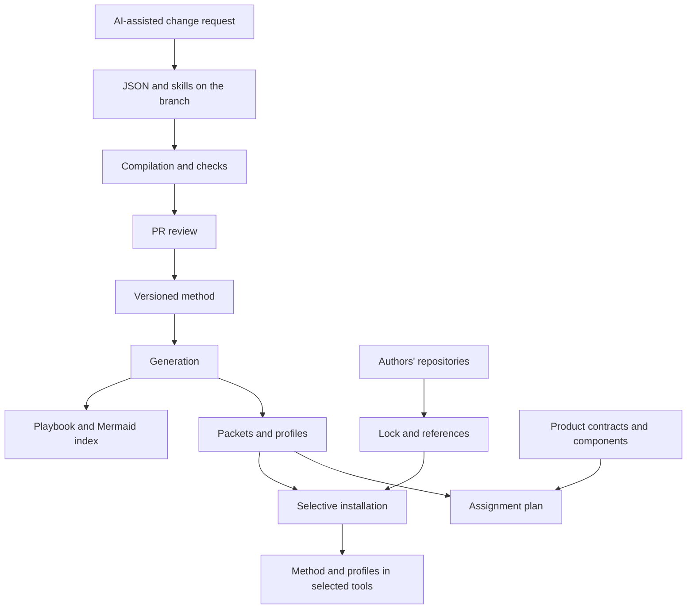

JADO defines the method’s current graph, profiles and skills. The repository preserves references and attribution for external dependencies; their contents are downloaded into installations. Product repositories own the domain, components, tokens and visual contracts.

Central configuration lives in versioned JSON files; Zod validates the structure. `lib/jado/schema.ts` contains shared checks and `jado/policies/guards.json` contains mandatory steps. Changes happen in sources with AI, on a branch and through a PR; the site exposes no workflow editor or write APIs.

Maps and profiles are derived from method sources. `jado:compile` generates Mermaid pages, the `jado/README.md` index, procedures and runtime packets. `sync:catalog` maintains the selective editorial catalog; `registry/jado-catalog.json` contains the method inventory. Upstream dependencies retain original instructions and attribution.

Fumadocs provides navigation, search and Markdown/LLM output. Selected tools execute assignments through native profiles. `jado-run` starts the method; `ask-jado` offers catalog guidance and clarifies missing decisions; `jado-flow` coordinates the route. The stdio MCP server reads and validates the method. JADO prepares adapters for Claude Code, Codex and OpenCode; in other tools, it installs skills without claiming equivalent subagent support.

Execution contracts require actual evidence: structural checks do not replace visual review, authentication or tool permissions. Compilation, checks and build precede the PR; installation updates are explicit.

In projects with a complete local installation, `.jado/` contains a self-contained snapshot of the graph, policies, catalog and procedures, with owned procedures in `.agents/skills/`, downloaded dependencies in `skills/`, graph and lock in `jado/` and catalog in `registry/`. It does not depend on a path to the source checkout. Updates are adopted through a new explicit installation.

Local setup uses the public `skills@1.7.0` CLI in a temporary folder, with telemetry disabled, to prepare paths for selected tools only. Individual skills are linked to the snapshot with relative links; parent directories and unrelated skills remain present. Adapted profiles are stored in `.jado/agents/<tool>/` and copied into native Claude Code, Codex or OpenCode directories. Models and settings remain tool-specific.

Local setup preserves existing Markdown and creates a short entry point when missing. Global mode and linking add a managed JADO block, preserving surrounding text. `.jado/migration.md` guides the AI through reviewing the actual instruction chain: entry point, overrides, referenced documents and nested rules. The [setup procedure](/docs/jado/setup-project) replaces existing design routing after diff review, preserving product rules. New-session checks attest to loading; the manifest records installed files, not native execution.

The domain, visual contract, components, tokens, Storybook and UX artifacts remain project authorities. Setup preserves their format and location; it does not move user flows and journeys into the method snapshot.

[Configuration](/docs/jado/configuration) · [Method](/docs/jado)

Global mode gathers the method and dependencies in `~/.jado`, replacing selected same-name skills with individual links and backups of the replaced copies. JADO removes those packages from the generic skills lock in `~/.agents/.skill-lock.json`. Opt-in refresh uses the same installer for upstream dependencies only. A method update preserves installed external versions; a full or skills update downloads from upstream. Linking prepares project entry points. Uninstalling reads the manifest in `.jado/install.json` and removes the JADO files that are unchanged since installation.

Graph activities remain defined by roles. Three dials shape each run: stage (explore, refine, ship) sets rigor and which reviews are required, involvement sets when the user is asked, and budget sets delegations, execution mode and model tier. Edges may be limited to stages, and `guards.json` records in which stages a protected check applies; the compiler rejects any path that bypasses a check in such a stage. Execution mode assigns procedures to the main agent, operational profiles with grouped activities, or separate specialist assignments. Independent reviews always run in a separate read-only context; in solo, a required review uses the one delegation a lean budget reserves for it.

A session must be able to read the global method and procedures: installation-process verification does not demonstrate AI permissions. When external access is blocked, use complete local setup. The chosen copy’s manifest and the contract’s `jadoRoot` keep graph, procedures and delegation consistent.

The compiler produces `jado/runtime/index.json`, which carries the dials, and one packet per route, without coordinates. Role procedures are generated skills that list their conditional skills directly; there are no role packets. Policies and guards come from the same versioned sources as maps. Operational reading uses the index, selected packet and only activated procedures; the full graph remains for method changes. R07 handoffs are protected by UX/canvas/code outcome. The planner distinguishes candidates, blocking requirements and resolved selections; it is not an executor.

The canonical root for new UX artifacts is `docs/ux/`, with four collections and JSON journeys. The JADO authoring procedure is separate from the UX Planner app, its skill and the extended dossier. Format compatibility does not imply that an app version with a fixed root already reads the new folder.
