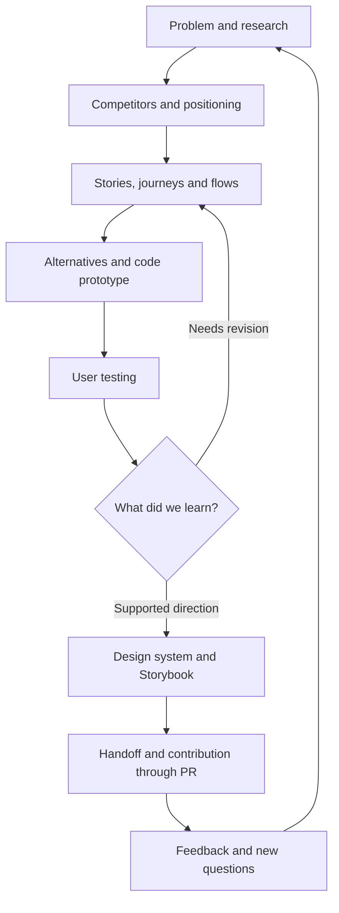

JADO brings together the [operating method](/docs/jado), Mermaid maps, skills and agent profiles for Claude Code, Codex and OpenCode in the same repository. The JSON graph is the source for routing and generated maps; the Fumadocs playbook preserves the process.

This playbook describes a designer’s working method: understand the problem, study alternatives, design and test the experience, organize the design system in code and share decisions with the team.

Code is a design tool: it makes it possible to try realistic interactions, test a prototype with users and contribute components and stories through PRs. The development team independently chooses architecture, tools, skills, task organization and the release process.

For an assignment, use `jado-run` and consult the [JADO router](/docs/jado/00-router). To read about the design cycle, use the [workflow map](/workflows) or the stages below.

| Stage | Question | Outcome |
| --- | --- | --- |
| [Initial analysis](/docs/discovery/problem) | What need and context? | Brief, evidence and hypotheses |
| [Competitors and references](/docs/discovery/competitors) | How is the same problem addressed? | Reasoned comparison and opportunities |
| [Positioning and copy](/docs/definition/messaging) | Who are we speaking to and what value do we promise? | Marketing context and messages to validate |
| [Definition](/docs/definition/feature) | What experience do we want to explore? | Scope and observable criteria |
| [Experience design](/docs/experience/traceability) | What paths, states and outcomes are needed? | Stories, journeys, flows and scenarios |
| [Code prototype](/docs/engineering/implement) | What interaction do we need people to try? | Prototype with declared limitations |
| [User testing](/docs/engineering/verification) | What works and what needs revision? | Observations, decisions and another iteration |
| [Design system](/docs/design-system/contract) | Which choices are reusable? | Tokens, components and stories |
| [Handoff](/docs/delivery/release) | What does the team need to understand and evaluate? | Evidence, experience specifications and scoped PRs |

## How to read evidence

**Observed** indicates a practice stated or verified in the sources. **Proposed** indicates an operating procedure to adapt together. **Unresolved** indicates an open decision. The research procedures proposed here do not attest to interviews or tests already conducted.

See [roles and boundaries](/docs/operating-model/roles) and [sources](/docs/governance/sources).
