<!-- Generated from jado/workflows.json. Do not edit. -->

## How to use this route

Stage, involvement and budget are the only run-level choices; execution mode follows the budget unless the user names one. Infer missing dials from the request and project defaults instead of asking, except in pair involvement. A review-only request authorizes findings, not product changes.

Stages: any (the route does not depend on design maturity). Work surface: as specified in the assignment. Involvement and budget come from the run's dials ([shared rules](/docs/jado/execution)).

## Map

Read from top to bottom. Labeled arrows show conditions; dashed arrows exist only in the stages they name; loops represent repairs within the budget. Instructions for each node appear below.

```mermaid
flowchart TD
  n_start(["Design request"])
  n_dials["Resolve stage, involvement and budget"]
  n_intent{"Is this a review-only request?"}
  n_review_kind{"Which review is required?"}
  n_review_ux["Review tasks and accessibility"]
  n_review_visual["Review visual output"]
  n_review_done(["Deliver findings and limits"])
  n_route{"Which route fits the outcome?"}
  n_ask["Resolve a route-changing gap"]
  n_rpatch["Patch"]
  n_rdecide["Decide with the user"]
  n_rbuild["Build"]
  n_rexplore["Explore alternatives"]
  n_rstaged["Staged delivery"]
  n_rcouncil["Council"]
  n_rvh["VariantHub"]
  n_rresearch["Visual research"]
  n_contract["Record the contract"]
  n_execute["Coordinate the route with jado-flow"]
  n_done(["Deliver result and run summary"])
  n_start --> n_dials
  n_dials --> n_intent
  n_intent -->|"Yes"| n_review_kind
  n_intent -->|"No"| n_route
  n_review_kind -->|"Tasks and behavior"| n_review_ux
  n_review_kind -->|"Composition and fidelity"| n_review_visual
  n_review_ux --> n_review_done
  n_review_visual --> n_review_done
  n_route -->|"Route-changing gap"| n_ask
  n_ask -->|"Gap resolved"| n_route
  n_route -->|"Precise fix"| n_rpatch
  n_route -->|"Open decision the user wants to make"| n_rdecide
  n_route -->|"Code from a direction or selected canvas"| n_rbuild
  n_route -->|"Paper alternatives"| n_rexplore
  n_route -->|"Several stages in one mandate"| n_rstaged
  n_route -->|"Competing perspectives on one decision"| n_rcouncil
  n_route -->|"VariantHub named"| n_rvh
  n_route -->|"References or moodboard"| n_rresearch
  n_rpatch --> n_contract
  n_rdecide --> n_contract
  n_rbuild --> n_contract
  n_rexplore --> n_contract
  n_rstaged --> n_contract
  n_rcouncil --> n_contract
  n_rvh --> n_contract
  n_rresearch --> n_contract
  n_contract --> n_execute
  n_execute --> n_done
```

## Input and outcome

- Input: Request and project materials.
- Outcome: Selected route and contract, or review-only findings.

## Work limits

Route cap: at most 8 new delegations, with 3 agents in parallel; at most 2 repair batches. The effective budget is the lower of this cap and the budget dial; the stage sets the fix passes per artifact. [Shared rules](/docs/jado/execution).

## Step instructions

### Design request

Read the request and the supplied project materials.

ID: `start`.

Continue with «Resolve stage, involvement and budget».

### Resolve stage, involvement and budget

Use explicit choices, then a valid checkpoint, then the project's 'JADO defaults' line, then policy defaults. When the stage is unstated, infer it: ideas, options or moodboards mean explore; a selected direction means refine; production code or release means ship. Announce the resolved dials in one line; ask only in pair involvement or when two readings would produce different work.

ID: `dials`.

Continue with «Is this a review-only request?».

### Is this a review-only request?

Keep product and canvas read-only when only review is assigned.

ID: `intent`.

- Yes → «Which review is required?».
- No → «Which route fits the outcome?».

### Which review is required?

Choose task and behavior review or composition and fidelity review from the request.

ID: `review_kind`.

- Tasks and behavior → «Review tasks and accessibility».
- Composition and fidelity → «Review visual output».

### Review tasks and accessibility

Collect read-only findings, evidence and coverage limits in an independent context.

[Skill instructions `jado-ux-reviewer`](/docs/automation/skills/jado-ux-reviewer) ID: `review_ux`.

Continue with «Deliver findings and limits».

### Review visual output

Collect read-only findings, evidence and coverage limits in an independent context.

[Skill instructions `jado-visual-reviewer`](/docs/automation/skills/jado-visual-reviewer) ID: `review_visual`.

Continue with «Deliver findings and limits».

### Deliver findings and limits

Return findings and unverified criteria; a review alone does not authorize fixes.

ID: `review_done`.

The route ends here.

### Which route fits the outcome?

Pick the smallest route that produces the requested result. A defined fix goes straight to the patch route.

ID: `route`.

- Route-changing gap → «Resolve a route-changing gap».
- Precise fix → «Patch».
- Open decision the user wants to make → «Decide with the user».
- Code from a direction or selected canvas → «Build».
- Paper alternatives → «Explore alternatives».
- Several stages in one mandate → «Staged delivery».
- Competing perspectives on one decision → «Council».
- VariantHub named → «VariantHub».
- References or moodboard → «Visual research».

### Resolve a route-changing gap

Use ask-jado only when two routes remain plausible and the choice changes the work; return to route selection with the answer.

[Skill instructions `ask-jado`](/docs/automation/skills/ask-jado) ID: `ask`.

- Gap resolved → «Which route fits the outcome?».

### Patch

Select R01.

[Route R01](/docs/jado/r01) ID: `rpatch`.

Continue with «Record the contract».

### Decide with the user

Select R03.

[Route R03](/docs/jado/r03) ID: `rdecide`.

Continue with «Record the contract».

### Build

Select R04.

[Route R04](/docs/jado/r04) ID: `rbuild`.

Continue with «Record the contract».

### Explore alternatives

Select R05.

[Route R05](/docs/jado/r05) ID: `rexplore`.

Continue with «Record the contract».

### Staged delivery

Select R07.

[Route R07](/docs/jado/r07) ID: `rstaged`.

Continue with «Record the contract».

### Council

Select R08.

[Route R08](/docs/jado/r08) ID: `rcouncil`.

Continue with «Record the contract».

### VariantHub

Select R09 only when the user names VariantHub.

[Route R09](/docs/jado/r09) ID: `rvh`.

Continue with «Record the contract».

### Visual research

Select visual-research for references or a moodboard.

[Route visual-research](/docs/jado/visual-research) ID: `rresearch`.

Continue with «Record the contract».

### Record the contract

Record route and revision, the dials with their resolved limits (variant count, maxFixPasses, independent review, evidence level, model tier), goal, scope, owner, writable files or nodes, settled decisions, stopAfter and remaining budget. Resolve evidence storage with jado-evidence-contract when the stage persists evidence.

ID: `contract`.

Continue with «Coordinate the route with jado-flow».

### Coordinate the route with jado-flow

Execute the selected route; pass the contract to each assignment and apply the involvement dial at checkpoints.

ID: `execute`.

Continue with «Deliver result and run summary».

### Deliver result and run summary

Declare complete, partial or blocked from checks actually performed, with the run summary.

ID: `done`.

The route ends here.

[Method and sources](/docs/jado)
