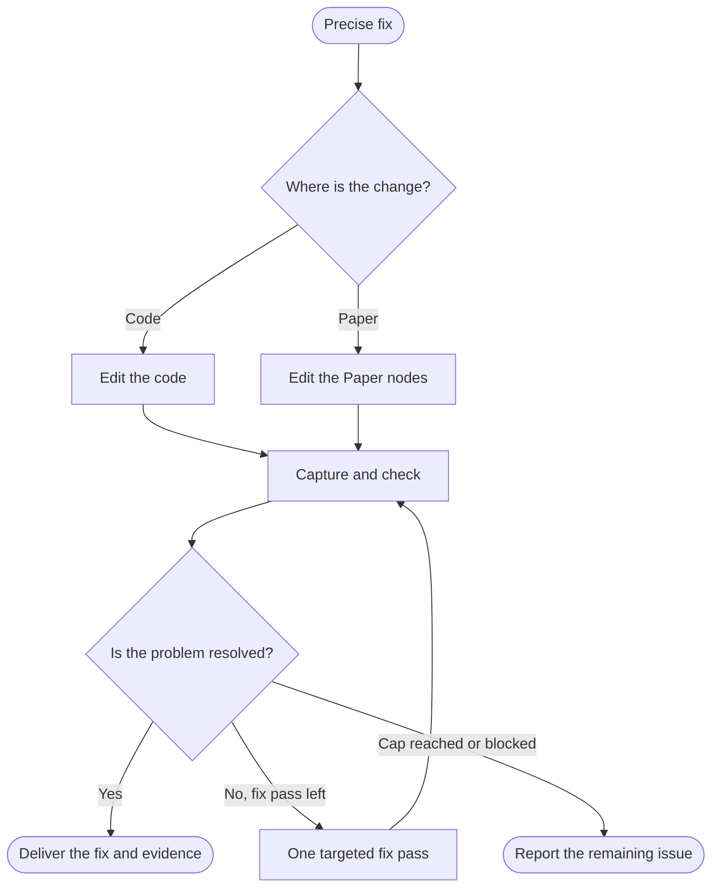

<!-- Generated from jado/workflows.json. Do not edit. -->

## How to use this route

The change is already defined: no exploration, research or delegation. One targeted fix pass after the first check; report remaining issues instead of iterating.

Stages: explore, refine, ship. Work surface: as specified in the assignment. Involvement and budget come from the run's dials ([shared rules](/docs/jado/execution)).

## Map

Read from top to bottom. Labeled arrows show conditions; dashed arrows exist only in the stages they name; loops represent repairs within the budget. Instructions for each node appear below.

## Input and outcome

- Input: Precise problem and affected files or nodes.
- Outcome: Local fix with current evidence.

## Work limits

Route cap: no new delegations; at most 1 repair batch. The effective budget is the lower of this cap and the budget dial; the stage sets the fix passes per artifact. [Shared rules](/docs/jado/execution).

## Step instructions

### Precise fix

Read the expected result, the target files or nodes and the constraints.

ID: `in`.

Continue with «Where is the change?».

### Where is the change?

Distinguish code from Paper nodes.

ID: `surface`.

- Code → «Edit the code».
- Paper → «Edit the Paper nodes».

### Edit the code

Apply jado-craft-core in code mode; change only the assigned scope.

[Skill instructions `jado-craft-core`](/docs/automation/skills/jado-craft-core) ID: `code`.

Continue with «Capture and check».

### Edit the Paper nodes

Read the affected nodes and an initial capture, then edit with jado-canvas-layout.

[Skill instructions `jado-canvas-layout`](/docs/automation/skills/jado-canvas-layout) ID: `paper`.

Continue with «Capture and check».

### Capture and check

Code: check the affected viewport and state in the browser. Paper: apply jado-canvas-verify to the changed nodes.

ID: `proof`.

Continue with «Is the problem resolved?».

### Is the problem resolved?

Compare the capture with the expected result.

ID: `gate`.

- Yes → «Deliver the fix and evidence».
- No, fix pass left → «One targeted fix pass».
- Cap reached or blocked → «Report the remaining issue».

### One targeted fix pass

Fix only what the check found, then capture again.

ID: `fix`.

Continue with «Capture and check».

### Deliver the fix and evidence

Return changed files or nodes and the capture.

ID: `done`.

The route ends here.

### Report the remaining issue

State what is still wrong and why the cap or a blocker stopped the work.

ID: `stop`.

The route ends here.

[Method and sources](/docs/jado)
