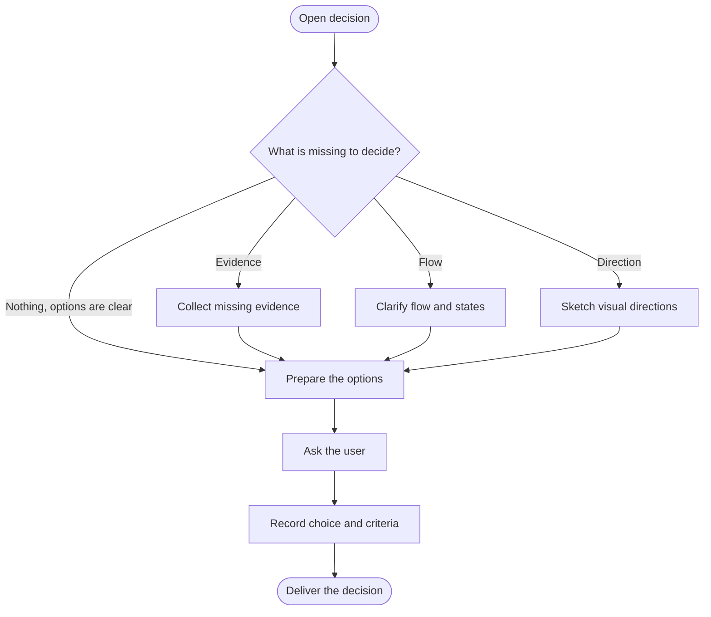

<!-- Generated from jado/workflows.json. Do not edit. -->

## How to use this route

Use this route when the user wants to make the call. In autopilot the coordinator decides and logs instead of selecting this route. Present 2–4 options with a recommendation through the native question tool; a planning request stops at the recorded decision.

Stages: explore, refine. Work surface: as specified in the assignment. Involvement and budget come from the run's dials ([shared rules](/docs/jado/execution)).

## Map

Read from top to bottom. Labeled arrows show conditions; dashed arrows exist only in the stages they name; loops represent repairs within the budget. Instructions for each node appear below.

## Input and outcome

- Input: Open decision and existing choices.
- Outcome: Recorded decision with criteria, or the assigned UX artifact.

## Work limits

Route cap: at most 2 new delegations, with 2 agents in parallel; at most 1 repair batch. The effective budget is the lower of this cap and the budget dial; the stage sets the fix passes per artifact. [Shared rules](/docs/jado/execution).

## Step instructions

### Open decision

Reuse recorded choices; isolate the one decision still open.

ID: `in`.

Continue with «What is missing to decide?».

### What is missing to decide?

Identify missing evidence, flow understanding or visual direction; skip straight to the choice when options are already clear.

ID: `missing`.

- Evidence → «Collect missing evidence».
- Flow → «Clarify flow and states».
- Direction → «Sketch visual directions».
- Nothing, options are clear → «Prepare the options».

### Collect missing evidence

Answer the bounded question that blocks the decision.

[Skill instructions `jado-researcher`](/docs/automation/skills/jado-researcher) ID: `research`.

Continue with «Prepare the options».

### Clarify flow and states

Answer the flow or state question that blocks the decision.

[Skill instructions `jado-ux-architect`](/docs/automation/skills/jado-ux-architect) ID: `ux`.

Continue with «Prepare the options».

### Sketch visual directions

Use art direction for open concepts; keep sketches at explore fidelity.

[Skill instructions `jado-art-direction`](/docs/automation/skills/jado-art-direction) ID: `visual`.

Continue with «Prepare the options».

### Prepare the options

Prepare 2–4 substantively different options with explicit criteria, tradeoffs and a recommended option.

ID: `choices`.

Continue with «Ask the user».

### Ask the user

Ask with the native question tool, recommended option first. Record the answer; it stays valid until its assumptions change.

ID: `human`.

Continue with «Record choice and criteria».

### Record choice and criteria

Record the selection, acceptance criteria and next scope.

ID: `contract`.

Continue with «Deliver the decision».

### Deliver the decision

Deliver the decision or the assigned UX artifact; canvas and code need their own mandate.

ID: `next`.

The route ends here.

[Method and sources](/docs/jado)
