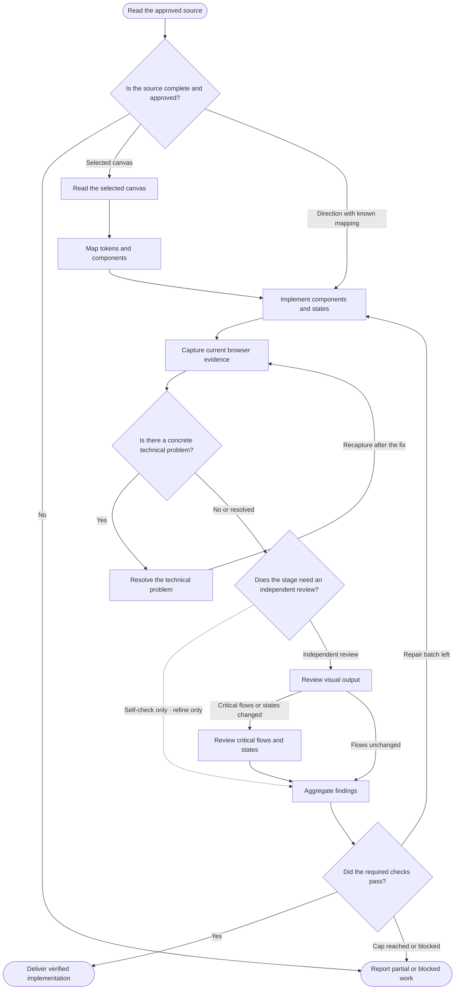

<!-- Generated from jado/workflows.json. Do not edit. -->

## How to use this route

Refine verifies the affected states with a self-check and adds an independent review when the budget is normal or deep. Ship always requires the independent visual review, plus UX review when critical flows or states change. Engineering work only for a concrete technical problem. Repairs return to the same builder as one aggregated batch.

Stages: refine, ship. Work surface: code. Involvement and budget come from the run's dials ([shared rules](/docs/jado/execution)).

## Map

Read from top to bottom. Labeled arrows show conditions; dashed arrows exist only in the stages they name; loops represent repairs within the budget. Instructions for each node appear below.

## Input and outcome

- Input: Approved direction or selected canvas, and the authorization to implement.
- Outcome: Implementation with current evidence and completed checks.

## Work limits

Route cap: at most 4 new delegations, with 2 agents in parallel; at most 2 repair batches. The effective budget is the lower of this cap and the budget dial; the stage sets the fix passes per artifact. [Shared rules](/docs/jado/execution).

## Step instructions

### Read the approved source

Identify the approved direction or selected canvas revision and the decision that authorizes implementation.

ID: `p`.

Continue with «Is the source complete and approved?».

### Is the source complete and approved?

Check completeness and the authorization.

ID: `ready`.

- No → «Report partial or blocked work».
- Selected canvas → «Read the selected canvas».
- Direction with known mapping → «Implement components and states».

### Read the selected canvas

Read tree, tokens, text and captures of the selected revision.

ID: `canvas`.

Continue with «Map tokens and components».

### Map tokens and components

Map canvas decisions to existing tokens and component APIs.

[Skill instructions `jado-design-systems`](/docs/automation/skills/jado-design-systems) ID: `map`.

Continue with «Implement components and states».

### Implement components and states

Use project tokens and components within scope; explain responsive adaptations.

[Skill instructions `jado-ui-builder`](/docs/automation/skills/jado-ui-builder) ID: `b`.

Continue with «Capture current browser evidence».

### Capture current browser evidence

Capture the current revision at target viewports and states; exercise keyboard and behavior that captures cannot prove.

ID: `proof`.

Continue with «Is there a concrete technical problem?».

### Is there a concrete technical problem?

A completed intervention does not reopen this branch.

ID: `risk`.

- Yes → «Resolve the technical problem».
- No or resolved → «Does the stage need an independent review?».

### Resolve the technical problem

Fix only the assigned issue and recapture.

[Skill instructions `jado-ui-engineer`](/docs/automation/skills/jado-ui-engineer) ID: `eng`.

- Recapture after the fix → «Capture current browser evidence».

### Does the stage need an independent review?

Ship: always. Refine: when the budget is normal or deep.

ID: `check`.

- Self-check only (refine only) → «Aggregate findings».
- Independent review → «Review visual output».

### Review visual output

Check rendering and fidelity read-only against the source.

[Skill instructions `jado-visual-reviewer`](/docs/automation/skills/jado-visual-reviewer) ID: `rev`.

- Critical flows or states changed → «Review critical flows and states».
- Flows unchanged → «Aggregate findings».

### Review critical flows and states

Check changed critical flows and states read-only.

[Skill instructions `jado-ux-reviewer`](/docs/automation/skills/jado-ux-reviewer) ID: `ux`.

Continue with «Aggregate findings».

### Aggregate findings

Deduplicate findings into one repair batch; drop findings outside scope or stage.

ID: `parent`.

Continue with «Did the required checks pass?».

### Did the required checks pass?

Verify completed checks against current evidence.

ID: `gate`.

- Yes → «Deliver verified implementation».
- Repair batch left → «Implement components and states».
- Cap reached or blocked → «Report partial or blocked work».

### Deliver verified implementation

Return implementation, passed checks and stated limits.

ID: `done`.

The route ends here.

### Report partial or blocked work

Identify unverified parts, the missing source or the budget block.

ID: `stop`.

The route ends here.

[Method and sources](/docs/jado)
