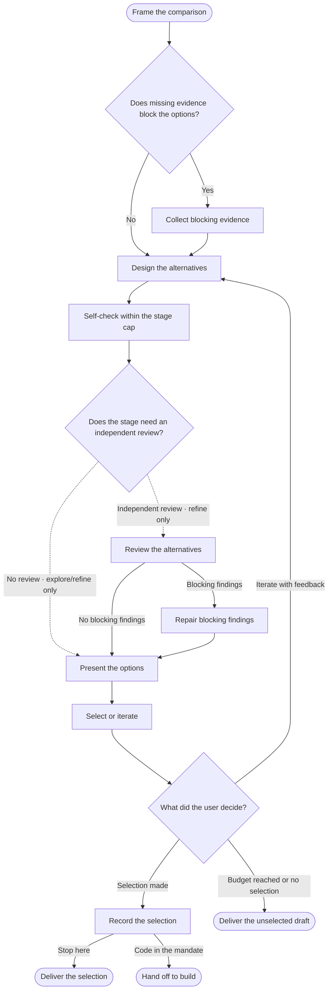

<!-- Generated from jado/workflows.json. Do not edit. -->

## How to use this route

Variant count: the user's number, otherwise the stage default (explore 4, refine 2). Each option tests a distinct structural or directional hypothesis with the same content; a palette or font swap alone is not an option. Explore has no independent review and at most one fix pass per artboard: speed and range matter more than polish. Refine adds jado-canvas-verify and, with a normal or deep budget, one independent review. Selection belongs to the user; in autopilot the coordinator records a provisional selection.

Stages: explore, refine. Work surface: Paper. Involvement and budget come from the run's dials ([shared rules](/docs/jado/execution)).

## Map

Read from top to bottom. Labeled arrows show conditions; dashed arrows exist only in the stages they name; loops represent repairs within the budget. Instructions for each node appear below.

## Input and outcome

- Input: Brief and comparison question.
- Outcome: Comparable alternatives and a recorded selection.

## Work limits

Route cap: at most 4 new delegations, with 3 agents in parallel; at most 2 repair batches. The effective budget is the lower of this cap and the budget dial; the stage sets the fix passes per artifact. [Shared rules](/docs/jado/execution).

## Step instructions

### Frame the comparison

Record the question, shared content and state, and the resolved variant count; report a budget shortfall instead of silently changing the count.

ID: `p`.

Continue with «Does missing evidence block the options?».

### Does missing evidence block the options?

Search only when a missing fact would change every option.

ID: `evidence`.

- Yes → «Collect blocking evidence».
- No → «Design the alternatives».

### Collect blocking evidence

Answer only the blocking question.

[Skill instructions `jado-researcher`](/docs/automation/skills/jado-researcher) ID: `r`.

Continue with «Design the alternatives».

### Design the alternatives

Explore: divergent hypotheses at low fidelity, built quickly. Refine: develop the selected direction with project tokens and states.

[Skill instructions `jado-visual-designer`](/docs/automation/skills/jado-visual-designer) ID: `d`.

Continue with «Self-check within the stage cap».

### Self-check within the stage cap

Explore: fix only broken text, clipping, overlaps or missing content, at most one pass. Refine: jado-canvas-verify, at most two passes. List remaining issues instead of polishing.

ID: `self`.

Continue with «Does the stage need an independent review?».

### Does the stage need an independent review?

Refine: when the budget is normal or deep. Explore: the self-check is enough.

ID: `check`.

- No review (explore, refine only) → «Present the options».
- Independent review (refine only) → «Review the alternatives».

### Review the alternatives

Compare captures with the criteria read-only; report only issues that affect the choice.

[Skill instructions `jado-visual-reviewer`](/docs/automation/skills/jado-visual-reviewer) ID: `review`.

- No blocking findings → «Present the options».
- Blocking findings → «Repair blocking findings».

### Repair blocking findings

The same designer spends one fix pass and recaptures; the flow continues with the fresh capture.

ID: `fix`.

Continue with «Present the options».

### Present the options

Show each option with its hypothesis, capture and known issues; recommend one with reasons.

ID: `present`.

Continue with «Select or iterate».

### Select or iterate

Checkpoints and pair: ask with the native question tool (each option, combine, iterate, more options). Autopilot: record the recommended option as a provisional selection in the decision log.

ID: `choose`.

Continue with «What did the user decide?».

### What did the user decide?

Iteration rounds consume the same budget.

ID: `next`.

- Iterate with feedback → «Design the alternatives».
- Selection made → «Record the selection».
- Budget reached or no selection → «Deliver the unselected draft».

### Record the selection

Preserve selected nodes, revision, content and the reasons behind the choice.

ID: `snap`.

- Stop here → «Deliver the selection».
- Code in the mandate → «Hand off to build».

### Deliver the selection

Return the comparison and selection; implementation starts in R04 on request.

ID: `done`.

The route ends here.

### Hand off to build

Continue to R04 only when code is in the mandate; in checkpoints involvement confirm first.

ID: `code`.

The route ends here.

### Deliver the unselected draft

Return the options and state the missing selection or reached budget.

ID: `stop`.

The route ends here.

[Method and sources](/docs/jado)
