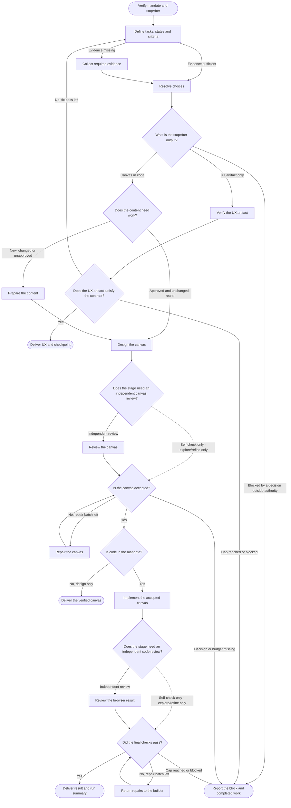

<!-- Generated from jado/workflows.json. Do not edit. -->

## How to use this route

Record stopAfter before starting: ux, canvas or code. Activate only needed roles; the coordinator may author. Ship requires independent canvas and code reviews; explore and refine use self-checks unless the budget adds a review. A UX deliverable does not authorize canvas, and a canvas deliverable does not authorize code. Canvas and code share the repair batches.

Stages: explore, refine, ship. Work surface: as specified in the assignment. Involvement and budget come from the run's dials ([shared rules](/docs/jado/execution)).

## Map

Read from top to bottom. Labeled arrows show conditions; dashed arrows exist only in the stages they name; loops represent repairs within the budget. Instructions for each node appear below.

## Input and outcome

- Input: Brief, delegated authority, stopAfter and budget.
- Outcome: Verified result, limits and run summary.

## Work limits

Route cap: at most 8 new delegations, with 3 agents in parallel; at most 2 repair batches. The effective budget is the lower of this cap and the budget dial; the stage sets the fix passes per artifact. [Shared rules](/docs/jado/execution).

## Step instructions

### Verify mandate and stopAfter

Check access, scope, delegated authority, stopAfter, dials and budget.

ID: `p`.

Continue with «Define tasks, states and criteria».

### Define tasks, states and criteria

Prepare brief, flow and acceptance criteria from available sources.

[Skill instructions `jado-ux-architect`](/docs/automation/skills/jado-ux-architect) ID: `brief`.

- Evidence missing → «Collect required evidence».
- Evidence sufficient → «Resolve choices».

### Collect required evidence

Close only the source gap that blocks dependent decisions.

[Skill instructions `jado-researcher`](/docs/automation/skills/jado-researcher) ID: `research`.

Continue with «Resolve choices».

### Resolve choices

Apply the involvement dial: decide and log, or batch the open questions at this checkpoint. Decisions outside delegated authority stop the dependent work.

ID: `decide`.

Continue with «What is the stopAfter output?».

### What is the stopAfter output?

UX stops after artifact verification; canvas or code needs visual design.

ID: `result`.

- UX artifact only → «Verify the UX artifact».
- Canvas or code → «Does the content need work?».
- Blocked by a decision outside authority → «Report the block and completed work».

### Verify the UX artifact

Check only the requested artifact, sources, IDs, links and states.

[Skill instructions `jado-evidence-contract`](/docs/automation/skills/jado-evidence-contract) ID: `ux_verify`.

Continue with «Does the UX artifact satisfy the contract?».

### Does the UX artifact satisfy the contract?

Return defects to the same author within the fix cap.

ID: `ux_gate`.

- Yes → «Deliver UX and checkpoint».
- No, fix pass left → «Define tasks, states and criteria».
- Cap reached or blocked → «Report the block and completed work».

### Deliver UX and checkpoint

Return the artifact with evidence; record next step, decisions and remaining budget.

ID: `ux_done`.

The route ends here.

### Does the content need work?

Reuse approved, unchanged copy as-is and record its source; new, changed or unapproved text needs content work.

ID: `copy_needed`.

- New, changed or unapproved → «Prepare the content».
- Approved and unchanged: reuse → «Design the canvas».

### Prepare the content

Prepare only new, changed or unapproved copy.

[Skill instructions `jado-content-designer`](/docs/automation/skills/jado-content-designer) ID: `copy`.

Continue with «Design the canvas».

### Design the canvas

Integrate the copy as the single canvas writer; follow the stage's variant count, fidelity and fix cap.

[Skill instructions `jado-visual-designer`](/docs/automation/skills/jado-visual-designer) ID: `design`.

Continue with «Does the stage need an independent canvas review?».

### Does the stage need an independent canvas review?

Ship: always. Refine: when the budget is normal or deep. Explore: the self-check is enough.

ID: `canvas_check`.

- Self-check only (explore, refine only) → «Is the canvas accepted?».
- Independent review → «Review the canvas».

### Review the canvas

Review captures and structure read-only before any implementation.

[Skill instructions `jado-visual-reviewer`](/docs/automation/skills/jado-visual-reviewer) ID: `canvas_review`.

Continue with «Is the canvas accepted?».

### Is the canvas accepted?

Check the criteria and the selection authority; in checkpoints involvement, confirm the canvas with the user before code.

ID: `canvas_gate`.

- Yes → «Is code in the mandate?».
- No, repair batch left → «Repair the canvas».
- Decision or budget missing → «Report the block and completed work».

### Repair the canvas

The same designer repairs one batch, recaptures and verifies the findings.

ID: `canvas_fix`.

Continue with «Is the canvas accepted?».

### Is code in the mandate?

Continue only when stopAfter is code.

ID: `code_scope`.

- Yes → «Implement the accepted canvas».
- No, design only → «Deliver the verified canvas».

### Deliver the verified canvas

Return canvas, revision, evidence and remaining budget.

ID: `canvas_done`.

The route ends here.

### Implement the accepted canvas

Implement the accepted direction with project components.

[Skill instructions `jado-ui-builder`](/docs/automation/skills/jado-ui-builder) ID: `b`.

Continue with «Does the stage need an independent code review?».

### Does the stage need an independent code review?

Ship: always, plus UX review for changed critical flows. Refine: when the budget is normal or deep.

ID: `code_check`.

- Self-check only (explore, refine only) → «Did the final checks pass?».
- Independent review → «Review the browser result».

### Review the browser result

Inspect current browser evidence read-only.

[Skill instructions `jado-visual-reviewer`](/docs/automation/skills/jado-visual-reviewer) ID: `review`.

Continue with «Did the final checks pass?».

### Did the final checks pass?

Compare checks and evidence with the contract.

ID: `gate`.

- Yes → «Deliver result and run summary».
- No, repair batch left → «Return repairs to the builder».
- Cap reached or blocked → «Report the block and completed work».

### Return repairs to the builder

One aggregated batch to the same author, who verifies the findings.

ID: `fix`.

Continue with «Did the final checks pass?».

### Deliver result and run summary

Return outputs, evidence, decision log, gaps and consumption.

ID: `done`.

The route ends here.

### Report the block and completed work

Record the block and verified parts; continue only independent work.

ID: `stop`.

The route ends here.

[Method and sources](/docs/jado)
