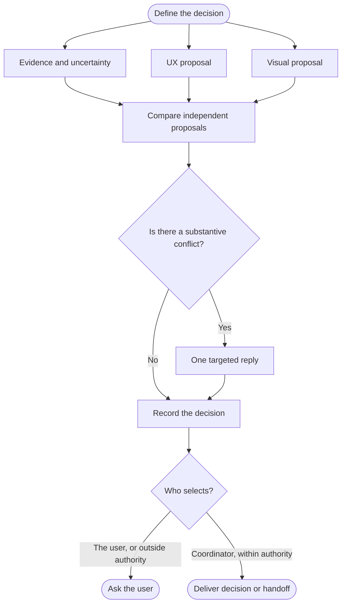

<!-- Generated from jado/workflows.json. Do not edit. -->

## How to use this route

Use only for a consequential choice with competing hypotheses, normally with a deep budget. Collect proposals before sharing them; allow one targeted reply on a substantive conflict. A majority cannot override evidence or user constraints. Record conclusions, rationale and dissent.

Stages: explore, refine. Work surface: as specified in the assignment. Involvement and budget come from the run's dials ([shared rules](/docs/jado/execution)).

## Map

Read from top to bottom. Labeled arrows show conditions; dashed arrows exist only in the stages they name; loops represent repairs within the budget. Instructions for each node appear below.

## Input and outcome

- Input: Decision question, criteria and constraints.
- Outcome: Reasoned decision or a focused question for the user.

## Work limits

Route cap: at most 6 new delegations, with 3 agents in parallel; at most 1 repair batch. The effective budget is the lower of this cap and the budget dial; the stage sets the fix passes per artifact. [Shared rules](/docs/jado/execution).

## Step instructions

### Define the decision

Give three specialists the same question, criteria and constraints.

ID: `p`.

- Next step → «Evidence and uncertainty».
- Next step → «UX proposal».
- Next step → «Visual proposal».

### Evidence and uncertainty

Collect documented evidence and state uncertainty.

[Skill instructions `jado-researcher`](/docs/automation/skills/jado-researcher) ID: `r`.

Continue with «Compare independent proposals».

### UX proposal

Propose the flow and its tradeoffs.

[Skill instructions `jado-ux-architect`](/docs/automation/skills/jado-ux-architect) ID: `u`.

Continue with «Compare independent proposals».

### Visual proposal

Propose hierarchy and composition consistent with the brief, at explore fidelity.

[Skill instructions `jado-visual-designer`](/docs/automation/skills/jado-visual-designer) ID: `v`.

Continue with «Compare independent proposals».

### Compare independent proposals

Collect every proposal before sharing any of them.

ID: `collect`.

Continue with «Is there a substantive conflict?».

### Is there a substantive conflict?

A conflict is substantive when it changes a criterion, constraint or decision.

ID: `conflict`.

- Yes → «One targeted reply».
- No → «Record the decision».

### One targeted reply

Ask only the involved specialists for one reply on the conflict.

ID: `reply`.

Continue with «Record the decision».

### Record the decision

Record selection and rationale, preserving assumptions and dissent.

ID: `decision`.

Continue with «Who selects?».

### Who selects?

Compare the choice with delegated authority and the involvement dial.

ID: `authority`.

- The user, or outside authority → «Ask the user».
- Coordinator, within authority → «Deliver decision or handoff».

### Ask the user

Present the options and recommendation with the native question tool and wait.

ID: `wait`.

The route ends here.

### Deliver decision or handoff

Deliver the decision; continue to R04 or R05 only when assigned, without resetting the budget.

ID: `execute`.

The route ends here.

[Method and sources](/docs/jado)
