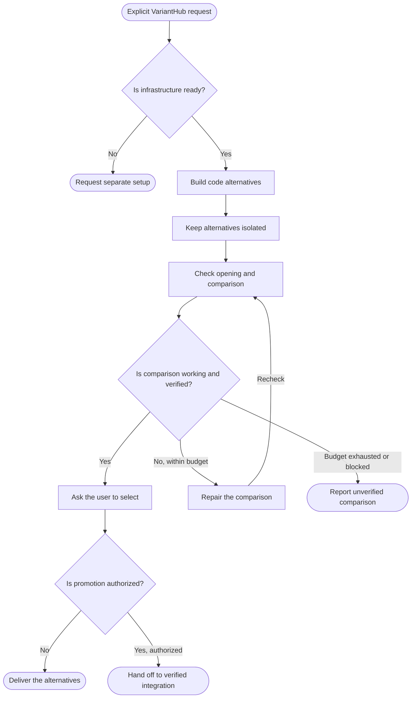

<!-- Generated from jado/workflows.json. Do not edit. -->

## How to use this route

A request for variants alone does not select VariantHub. Use the requested count, distinct structural hypotheses and comparable content and states. Selecting a variant and promoting it into shared code are separate decisions. Missing infrastructure requires a separate setup mandate.

Stages: explore, refine. Work surface: VariantHub. Involvement and budget come from the run's dials ([shared rules](/docs/jado/execution)).

## Map

Read from top to bottom. Labeled arrows show conditions; dashed arrows exist only in the stages they name; loops represent repairs within the budget. Instructions for each node appear below.

## Input and outcome

- Input: Explicit VariantHub request and ready infrastructure.
- Outcome: Comparable alternatives and any authorized promotion.

## Work limits

Route cap: at most 4 new delegations, with 2 agents in parallel; at most 1 repair batch. The effective budget is the lower of this cap and the budget dial; the stage sets the fix passes per artifact. [Shared rules](/docs/jado/execution).

## Step instructions

### Explicit VariantHub request

Record the request to use VariantHub and the requested number of alternatives.

ID: `p`.

Continue with «Is infrastructure ready?».

### Is infrastructure ready?

Check the project infrastructure before building alternatives.

ID: `ready`.

- No → «Request separate setup».
- Yes → «Build code alternatives».

### Request separate setup

varianthub-builder needs a separately authorized setup assignment.

ID: `blocked`.

The route ends here.

### Build code alternatives

Use varianthub Explore with the requested count and one distinct structural hypothesis per alternative.

[Skill instructions `jado-ui-builder`](/docs/automation/skills/jado-ui-builder) ID: `b`.

Continue with «Keep alternatives isolated».

### Keep alternatives isolated

Keep comparable content and states. Production code imports only a promoted alternative.

ID: `variants`.

Continue with «Check opening and comparison».

### Check opening and comparison

Open catalog and direct routes; check comparison, visibility and reload for every option.

ID: `smoke`.

Continue with «Is comparison working and verified?».

### Is comparison working and verified?

Check visual comparison and targeted behavior for required functions.

ID: `gate`.

- Yes → «Ask the user to select».
- No, within budget → «Repair the comparison».
- Budget exhausted or blocked → «Report unverified comparison».

### Ask the user to select

Present the verified comparison with the native question tool; in autopilot record a provisional selection and leave promotion to the user.

ID: `human`.

Continue with «Is promotion authorized?».

### Repair the comparison

Use one repair batch and rerun the affected checks.

ID: `fix`.

- Recheck → «Check opening and comparison».

### Report unverified comparison

Deliver a partial result identifying what remains unverified.

ID: `stop`.

The route ends here.

### Is promotion authorized?

Check that integration into shared production code is explicitly authorized.

ID: `promote`.

- No → «Deliver the alternatives».
- Yes, authorized → «Hand off to verified integration».

### Deliver the alternatives

Return alternatives and comparison checks.

ID: `done`.

The route ends here.

### Hand off to verified integration

Use varianthub Promote and R04 integration checks.

ID: `production`.

The route ends here.

[Method and sources](/docs/jado)
