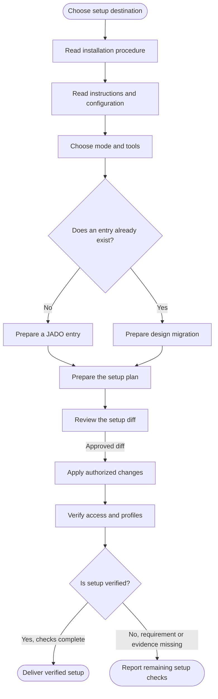

<!-- Generated from jado/workflows.json. Do not edit. -->

## How to use this route

Follow jado-install for the plan, semantic migration and access verification. Local and global setup give selected JADO skills priority with backups; external packages come from upstream. Linking updates project entry points. Apply updates through the CLI for the selected destination.

Stages: any (the route does not depend on design maturity). Work surface: as specified in the assignment. Involvement and budget come from the run's dials ([shared rules](/docs/jado/execution)).

## Map

Read from top to bottom. Labeled arrows show conditions; dashed arrows exist only in the stages they name; loops represent repairs within the budget. Instructions for each node appear below.

## Input and outcome

- Input: JADO source and local or global destination; Existing instructions and configuration; Selected AI tools.
- Outcome: Installed method or linked project; Migrated design instructions and setup verification.

## Work limits

Route cap: no new delegations; no additional repair batch. The effective budget is the lower of this cap and the budget dial; the stage sets the fix passes per artifact. [Shared rules](/docs/jado/execution).

## Step instructions

### Choose setup destination

Locate the JADO source and choose local, global or linked setup.

ID: `start`.

Continue with «Read installation procedure».

### Read installation procedure

Follow jado-install. Setup is a separate assignment from product work.

[Skill instructions `jado-install`](/docs/automation/skills/jado-install) ID: `procedure`.

Continue with «Read instructions and configuration».

### Read instructions and configuration

Inspect effective entries, overrides, linked Markdown, nested rules and Git state. For global setup inspect the tools' user-level instructions. Preserve product documents and existing UX artifact locations until migration is verified.

ID: `read`.

Continue with «Choose mode and tools».

### Choose mode and tools

Reuse received choices. Local is self-contained; global manages the user-level method and upstream dependencies; linked setup adds a project entry. Claude Code, Codex and OpenCode have native adapters; other skills CLI targets receive skills only in local setup.

ID: `tools`.

Continue with «Does an entry already exist?».

### Does an entry already exist?

Inspect the effective instructions at the selected destination.

ID: `existing`.

- No → «Prepare a JADO entry».
- Yes → «Prepare design migration».

### Prepare a JADO entry

Prepare a concise method pointer while preserving project constraints.

ID: `create`.

Continue with «Prepare the setup plan».

### Prepare design migration

Update the effective entry and reached files. Replace incompatible routers while preserving domain, design system, verification, Git and release rules.

ID: `migrate`.

Continue with «Prepare the setup plan».

### Prepare the setup plan

Run install, link or update with --dry-run and retain the revision. The plan shows files, references and conflicts; router replacement also needs a semantic migration diff.

ID: `files`.

Continue with «Review the setup diff».

### Review the setup diff

Review proposed destination files and instruction changes before applying them. Honor authorization already supplied in the task.

ID: `review`.

- Approved diff → «Apply authorized changes».

### Apply authorized changes

Apply the reviewed plan with --yes and --revision HASH. The CLI checks collisions and hashes and retains backups. Apply the reviewed instruction diff with verified backup; commit or push needs its own authorization.

ID: `apply`.

Continue with «Verify access and profiles».

### Verify access and profiles

Check diff, links, catalog and instructions. For linked setup verify external reads in the AI session as well as the CLI. Use a local copy if external access is blocked. Verify route and available native profiles in a fresh session.

ID: `verify`.

Continue with «Is setup verified?».

### Is setup verified?

Distinguish completed checks from prepared files still awaiting load verification or a missing requirement.

ID: `gate`.

- Yes, checks complete → «Deliver verified setup».
- No, requirement or evidence missing → «Report remaining setup checks».

### Deliver verified setup

Return source, changed files and instructions with completed checks.

ID: `done`.

The route ends here.

### Report remaining setup checks

Return prepared setup and state missing requirements or verification; generated files alone do not prove native execution.

ID: `stop`.

The route ends here.

[Method and sources](/docs/jado)
