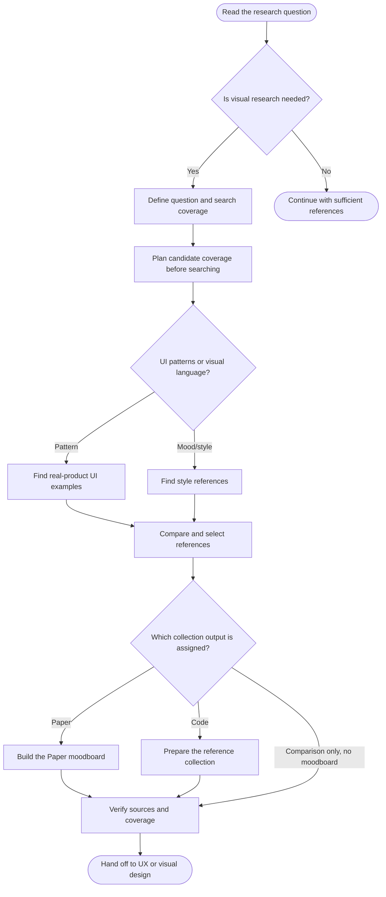

<!-- Generated from jado/workflows.json. Do not edit. -->

## How to use this route

The question determines sources: UI patterns use real products; visual language may use Pinterest, images and websites. Apply jado-reference-analysis before search and again when comparing inspected candidates. A moodboard is a conditional output.

Stages: explore, refine. Work surface: as specified in the assignment. Involvement and budget come from the run's dials ([shared rules](/docs/jado/execution)).

## Map

Read from top to bottom. Labeled arrows show conditions; dashed arrows exist only in the stages they name; loops represent repairs within the budget. Instructions for each node appear below.

## Input and outcome

- Input: Research question, brief and available references.
- Outcome: Reasoned reference selection or assigned moodboard with limits.

## Work limits

Route cap: at most 2 new delegations, with 1 agent in parallel; at most 1 repair batch. The effective budget is the lower of this cap and the budget dial; the stage sets the fix passes per artifact. [Shared rules](/docs/jado/execution).

## Step instructions

### Read the research question

Read the brief, sources and evidence gaps.

ID: `start`.

Continue with «Is visual research needed?».

### Is visual research needed?

Search when a missing UI pattern or style reference is necessary for a decision.

ID: `need`.

- Yes → «Define question and search coverage».
- No → «Continue with sufficient references».

### Define question and search coverage

Frame the assignment with jado-visual-researcher; record audience, platform, domain, constraints and candidate rationale before search.

[Skill instructions `jado-visual-researcher`](/docs/automation/skills/jado-visual-researcher) ID: `researcher`.

Continue with «Plan candidate coverage before searching».

### Continue with sufficient references

Reuse available sources and record why new research is unnecessary.

ID: `skip`.

The route ends here.

### Plan candidate coverage before searching

Define comparable candidates, source relevance and a search budget with jado-reference-analysis. Explore: a broad, quick sweep of 6–10 candidates. Refine: fewer, deeper comparisons.

[Skill instructions `jado-reference-analysis`](/docs/automation/skills/jado-reference-analysis) ID: `reference-plan`.

Continue with «UI patterns or visual language?».

### UI patterns or visual language?

Separate component and composition comparisons from style research. Use jado-ux-architect for sequences, decisions and recovery.

ID: `mode`.

- Pattern → «Find real-product UI examples».
- Mood/style → «Find style references».

### Find real-product UI examples

Use mobbin-search for relevant inspected screens. Screen search alone does not prove a complete flow.

[Skill instructions `mobbin-search`](/docs/automation/skills/mobbin-search) ID: `mobbin`.

Continue with «Compare and select references».

### Find style references

Use available browser tools for accessible Pinterest, image search and relevant product or editorial websites.

Reference: `browser`. ID: `web`.

Continue with «Compare and select references».

### Compare and select references

Apply jado-reference-analysis to inspected candidates. Record selected and rejected reasons, transferable ideas and limits; search order and brand fame are not quality evidence.

[Skill instructions `jado-reference-analysis`](/docs/automation/skills/jado-reference-analysis) ID: `curate`.

Continue with «Which collection output is assigned?».

### Which collection output is assigned?

A pattern comparison may end with findings. Build a moodboard only when assigned, in Paper or project-owned files.

ID: `surface`.

- Paper → «Build the Paper moodboard».
- Code → «Prepare the reference collection».
- Comparison only, no moodboard → «Verify sources and coverage».

### Build the Paper moodboard

Organize inspected references in the assigned document as its single writer, using jado-canvas-layout.

Reference: `paper`. ID: `paper`.

Continue with «Verify sources and coverage».

### Prepare the reference collection

Write references.json and moodboard.md at the project-owned location resolved by jado-evidence-contract. Include images only through available authorized tools.

ID: `pack`.

Continue with «Verify sources and coverage».

### Verify sources and coverage

Record inspected sources, selection coverage, actual evidence paths and missing observations.

[Skill instructions `jado-evidence-contract`](/docs/automation/skills/jado-evidence-contract) ID: `evidence`.

Continue with «Hand off to UX or visual design».

### Hand off to UX or visual design

Transfer sequence findings to UX and style or composition references to visual work, with selection criteria and limits.

ID: `done`.

The route ends here.

[Method and sources](/docs/jado)
