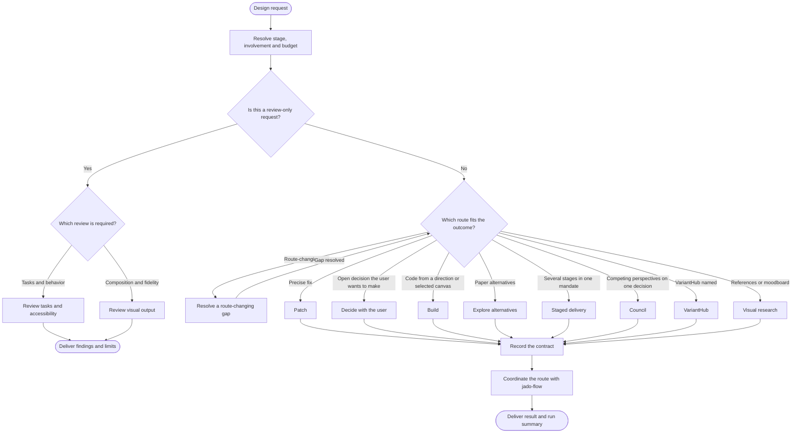
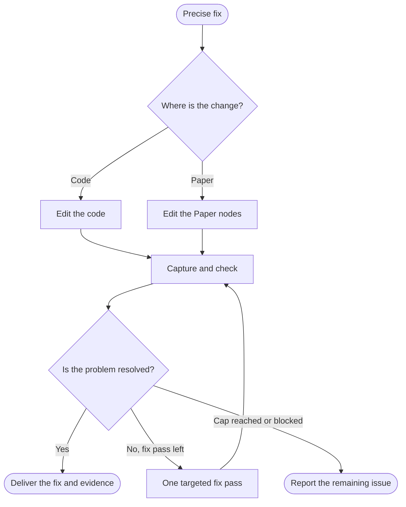
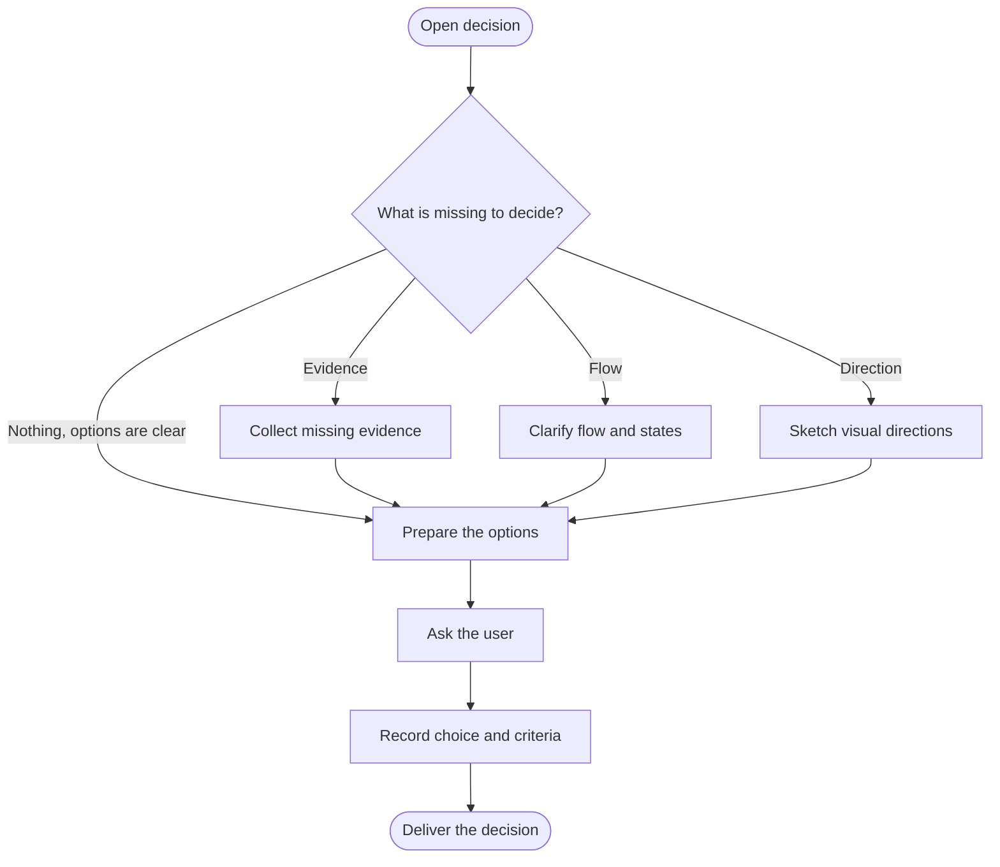
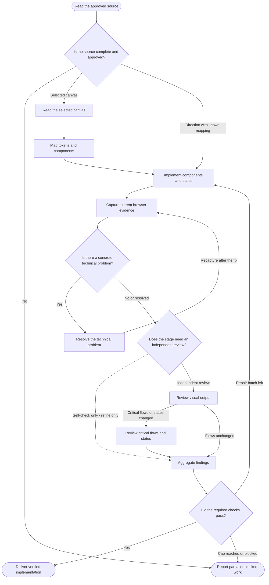
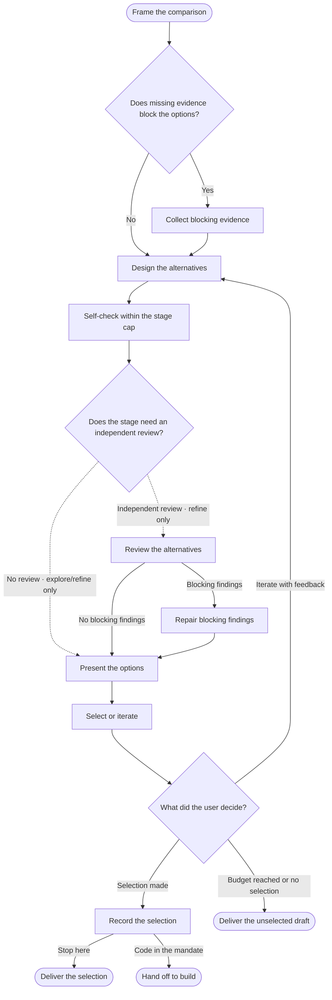
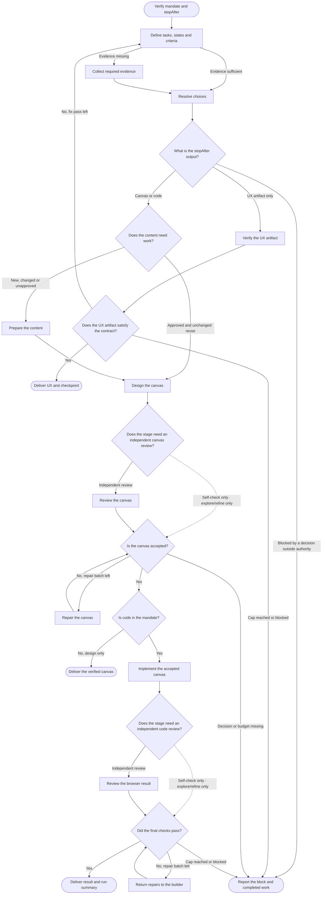
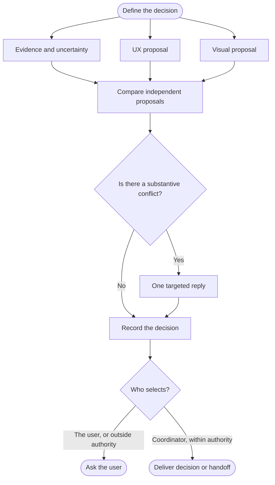
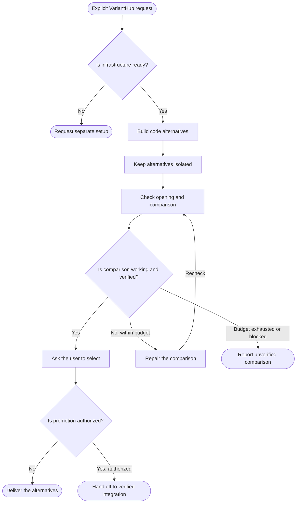
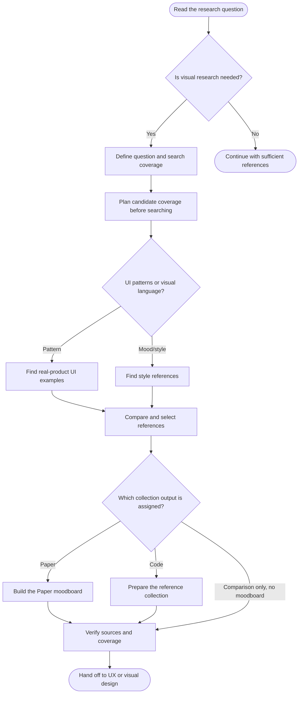
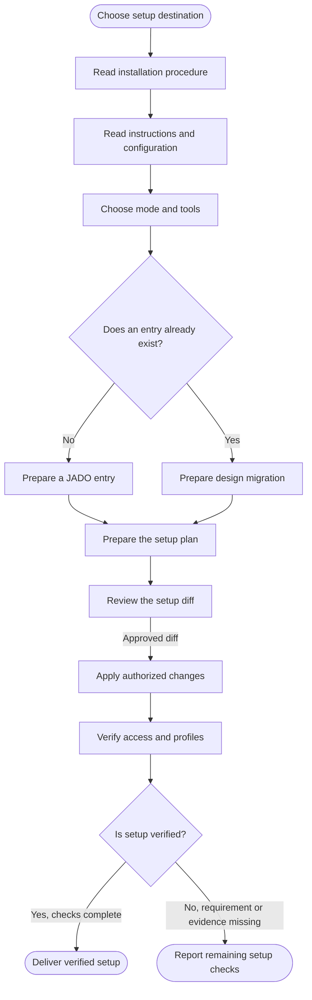

# JADO workflow diagrams

<!-- Generated from jado/workflows.json. Do not edit. -->

Read-only diagrams from the canonical graph. Operational workflows define activities and delivery checks; dashed arrows exist only in the stages they name. Follow the linked playbook page for conditions, permissions and completion checks. Edit the source graph on a branch, regenerate, verify and review the diff in a pull request.

## Routing

### 00-router — Entry and route selection

Resolve the three dials, then pick the smallest route that delivers the requested outcome.

[Source page](../content/docs/jado/00-router.md) · [Playbook page](/docs/jado/00-router)

## Operational workflows

### R01 — R01 · Patch

Apply a precise, reversible fix to code or Paper nodes and check the result.

[Source page](../content/docs/jado/r01.md) · [Playbook page](/docs/jado/r01)

### R03 — R03 · Decide with the user

Resolve one open decision with the user through a few substantively different options.

[Source page](../content/docs/jado/r03.md) · [Playbook page](/docs/jado/r03)

### R04 — R04 · Build

Implement an approved direction or a selected canvas in code and verify it at the stage's rigor.

[Source page](../content/docs/jado/r04.md) · [Playbook page](/docs/jado/r04)

### R05 — R05 · Explore alternatives

Produce comparable Paper alternatives fast, let the user pick or iterate, then record the selection.

[Source page](../content/docs/jado/r05.md) · [Playbook page](/docs/jado/r05)

### R07 — R07 · Staged delivery

Carry one mandate through UX, canvas and code up to the recorded stopAfter, with shared budget and stage-appropriate checks.

[Source page](../content/docs/jado/r07.md) · [Playbook page](/docs/jado/r07)

### R08 — R08 · Council

Collect independent research, UX and visual proposals on one consequential decision, then decide or ask.

[Source page](../content/docs/jado/r08.md) · [Playbook page](/docs/jado/r08)

### R09 — R09 · VariantHub on explicit request

Use VariantHub for code alternatives only when the user explicitly selects it.

[Source page](../content/docs/jado/r09.md) · [Playbook page](/docs/jado/r09)

### visual-research — Visual research · patterns and style

Select comparable UI or style references and deliver the assigned comparison or moodboard.

[Source page](../content/docs/jado/visual-research.md) · [Playbook page](/docs/jado/visual-research)

## Setup and governance

### setup-project — Setup · Install or link JADO

Choose local, global or linked setup, prepare selected tools and migrate design instructions.

[Source page](../content/docs/jado/setup-project.md) · [Playbook page](/docs/jado/setup-project)

