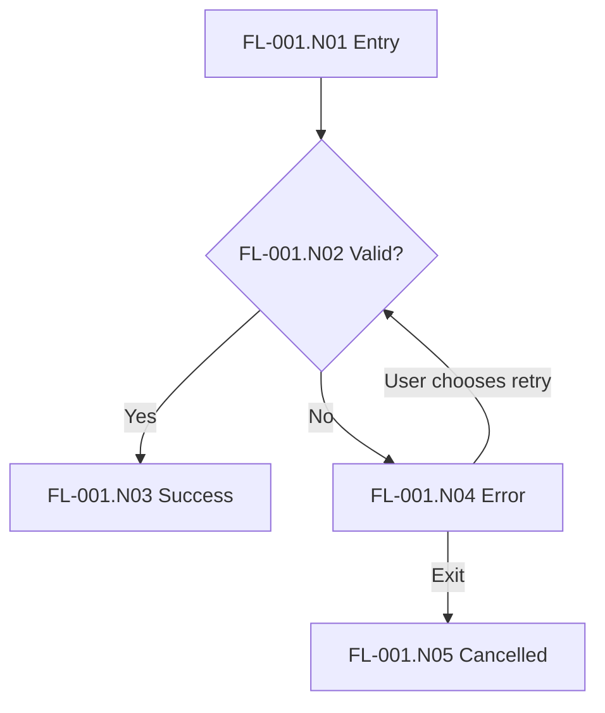

# FL-001 — Title

Status: proposed. Sources: E-001. Story: US-001. Journey: JY-001.S01.

## Entry and outcomes

Record preconditions and terminal outcomes. Adapt this synthetic example to the domain.

## Node register

| ID | Type | Contract | Validation |
| --- | --- | --- | --- |
| FL-001.N01 | entry | Entry is allowed | VAL-001 |
| FL-001.N02 | decision | Domain-specific check | VAL-001, VAL-002 |
| FL-001.N03 | success | Required outcome reached | VAL-001 |
| FL-001.N04 | error/recovery | Understandable error, user-controlled retry | VAL-002 |
| FL-001.N05 | cancellation | Defined exit | VAL-003 |

## Questions and limits

Mark VAL IDs as confirmed only after canonical scenarios exist. Verify that every link resolves to an actual anchor.
