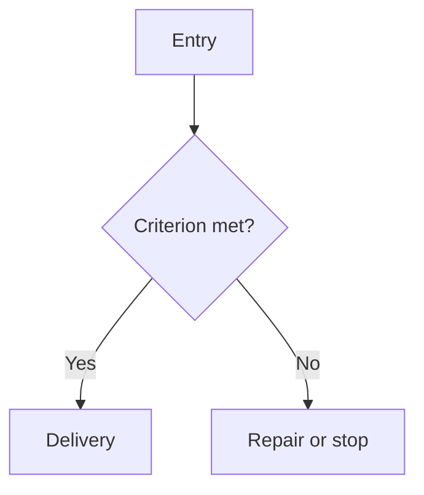

## Purpose and entry

State the problem, trigger, preconditions and boundaries.

## Procedure

1. Read the sources until every required input is resolved or marked blocked.
2. Execute the decision steps and record the selected branch.
3. Verify the result against the completion criterion and hand off to the next workflow.

## Map

## Completion criterion

Define the observable outcome, required evidence and decision owner.

## Failure modes

Record recurring errors and their consequences.

## Sources and links

Link the exact source, revision, evidence limits and adjacent workflows.
